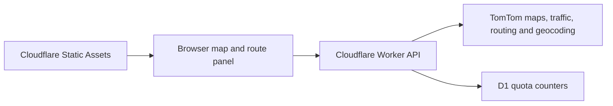

# Kochi Traffic Prediction System — implementation plan

Date: October 29, 2026 (Asia/Kolkata).
Repository: [saimadhav10/Kochi-Traffic-Prediction-System](https://github.com/saimadhav10/Kochi-Traffic-Prediction-System).
Working branch: `main`.
Status: local configuration, provider checks, live map/road details, and route planning are implemented. Desktop and mobile preview interactions have been inspected; 23 automated tests pass. Routes support address searches, map pins, car/motorcycle modes, alternatives, and now/+1-hour estimates. The current key is absent from the browser build. Durable quotas, account-specific free allowances, provider caching permissions, and production deployment verification remain outstanding. See [SETUP.md](SETUP.md).

## Product flow

1. Open a clean, light map of wider Kochi with current provider traffic colors and a readable legend.
2. Set origin/destination using map pins or a submitted address search. Device location is optional and requested only through an explicit control.
3. Select Car or Two-wheeler and departure Now or In one hour.
4. Display a recommended route, available alternatives, distance, estimated duration, and departure/arrival times.
5. Select an observed road to inspect its current speed, free-flow speed, and available quality details.
6. Show refresh status and clear unavailable-data or service-limit states.

Proposed defaults: no sign-in, accounts, saved trips, location history, ads, or payments. Keep current traffic observations distinct from future route estimates. Do not fabricate observations, vehicle positions, or two-wheeler speed advantages.

## Recommended architecture

| Component | Choice | Role |
| --- | --- | --- |
| Frontend | TypeScript browser application and MapLibre GL JS | Responsive map and route panel |
| Basemap and traffic | TomTom map and traffic flow tiles | Wider-area road and congestion display |
| Selected-road details | TomTom Flow Segment Data | Numeric speeds on selection, without citywide polling |
| Routing | TomTom Calculate Route | Car/motorcycle routes and now/+60-minute departure estimates |
| Address lookup | TomTom Geocoding | Explicit address submission; map pins remain available |
| Hosting and server API | Cloudflare Workers with Static Assets | Static frontend and restricted server-side provider adapter |
| Usage accounting | Cloudflare D1 | Durable quota counters; no user travel history |

Validate coordinates, operating bounds, tile zooms, vehicle modes, and departure inputs. Keep keys out of browser bundles, URLs exposed to the browser, logs, source, and chat. Do not implement an open proxy.

Provider caching rights and permitted cache lifetimes still need verification. Do not make the design depend on unverified caching or historical data storage. Preserve acquisition time in any permitted cache.

## Free-tier usage plan

Planning figures checked October 29, 2026; the new account's actual entitlements must be verified.

| Service | Published free allowance | Proposed application ceiling |
| --- | --- | --- |
| TomTom map tiles | 200,000/month | 120,000/month |
| TomTom traffic raster tiles | 200,000/month | 120,000/month |
| TomTom routing | 20,000/month | 12,000/month |
| TomTom traffic segment data | 20,000/month | 8,000/month |
| TomTom geocoding | 20,000/month | 8,000/month |
| Cloudflare Worker requests | 100,000/day | Admission ceiling below the limit, including tile proxy traffic |
| Cloudflare D1 | 5 million rows read/day; 100,000 rows written/day; 5 GB storage | Reserve capacity for counter and index writes |

Fetch traffic tiles for the visible map, refresh on a 15-minute cadence, and pause background refresh in hidden tabs. Query road speeds on selection and routes on explicit requests or relevant input changes. Avoid per-keystroke geocoding.

Use atomic quota reservations before provider calls, burst limits, timeouts, and bounded retries. Count actual upstream calls and align reset periods with the account plan. Include D1 writes in the budget. Stop forwarding requests if usage accounting is unavailable. Display clear quota-limit states without enabling paid overages.

For illustration, 12,000 monthly routing requests supports about 6,000 comparisons if each uses one call for now and another for +1 hour. This is not a visitor estimate; tiles, searches, retries, and repeated requests also consume allowance.

## Implementation milestones

| Milestone | Estimated focused effort | Completion evidence |
| --- | --- | --- |
| 1. Configuration and provider access | 1–2 hours | Project-owned TomTom key configured locally; actual free allowances verified; Cloudflare access confirmed; successful Kochi traffic/geocoding/tile and both-mode routing checks |
| 2. Map and road details | 2–3 hours | Light map across wider Kochi, traffic overlay, selected-road speeds, attribution, missing-data states |
| 3. Route flow | 2–3 hours | Pins/address submission, both vehicle modes, now/+1 hour, alternatives, times, responsive panel |
| 4. Quotas and failure handling | 1–2 hours | Durable budget enforcement, burst control, bounded retries, timeouts, hidden-tab behavior, graceful errors |
| 5. Verification and public deployment | 1–2 hours | Relevant automated checks and visual/mobile review pass; deployed URL passes smoke checks |

Estimated total: 7–12 focused hours plus account/setup delays. The October 30 target is conditional on these checks. Clarify material scope changes before implementing them.

Earlier sample checks demonstrated technical provider capabilities, but the reset does not carry forward code, datasets, models, credentials, or completed-milestone claims. Verify the project-owned key and current configuration in the fresh implementation.

## Launch checks

- Sample traffic observations in central Kochi, Kakkanad, Kalamassery, Aluva, and Tripunithura. Country-level support does not establish observation coverage on every street.
- Test representative short and cross-area journeys for both modes and handle unsupported motorcycle sections. TomTom marks motorcycle routing as beta; disclose the provider limitation.
- Verify +1-hour departures, timezone offsets, and day-boundary behavior against returned provider times.
- Test missing traffic, invalid/out-of-area inputs, no routes, authentication failures, provider quotas, timeouts, and counter-store failures.
- Verify atomic reservations under concurrent requests at the quota boundary and that retries stay within budget.
- Review desktop and narrow mobile layouts, keyboard operation, contrast, attribution, and a legend that does not rely on color alone.
- Verify data-age wording and absence of credentials in source, builds, source maps, logs, and tracked environment files.
- Run production build, type checks, and focused tests for provider normalization, time handling, quotas, and critical UI states. Smoke-test the public deployment.

## Repository workflow

Develop this project directly on `main`, with focused commits using the user's existing Git identity and normal pushes to the canonical repository. Keep local secrets ignored before entering credentials. Commit blank templates only. The previous local implementation and backups were removed at the user's request; retain the agreed requirements and this plan as the basis for new development.

Use a key belonging to the project owner's TomTom account. The old key's account is not accessible to the user; revocation is controlled by that account's owner. The fresh project must not depend on the old credential.

Custom forecasting comes later and requires a permitted, representative dataset plus evaluation against later real observations and simple baselines. Synthetic data alone does not establish real-world accuracy.

## Primary references

- [TomTom pricing](https://docs.tomtom.com/pricing)
- [TomTom routing and vehicle modes](https://docs.tomtom.com/routing-api/documentation/tomtom-maps/v1/calculate-route)
- [TomTom routing coverage](https://docs.tomtom.com/routing-api/documentation/tomtom-maps/v1/product-information/market-coverage)
- [TomTom selected-road traffic data](https://docs.tomtom.com/traffic-api/documentation/tomtom-maps/v1/traffic-flow/flow-segment-data)
- [MapLibre GL JS](https://maplibre.org/maplibre-gl-js/docs/)
- [Cloudflare Static Assets](https://developers.cloudflare.com/workers/static-assets/)
- [Cloudflare Worker limits](https://developers.cloudflare.com/workers/platform/limits/)
- [Cloudflare D1 pricing](https://developers.cloudflare.com/d1/platform/pricing/)
